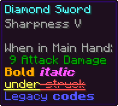
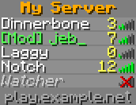

# minecraft-visual-renderer

[](https://jitpack.io/#ultranetworkmc/minecraft-visual-renderer)

Render Minecraft item tooltips and the player list (tab list) to images, matching what the 26.3 client draws.

| Tooltip | Tab list |
| --- | --- |
|  |  |

## How close to vanilla is it?

The layout, colours, shadows, bold/italic/underline/strikethrough, obfuscation, legacy `§` codes, translations,
sorting, column logic and signal bars follow the client's own rendering code.

How the text looks depends on the `RenderEnvironment`:

- **With vanilla assets** (`RenderEnvironment.fromAssets`): pixel-identical to the game. This includes Unifont for
  non-Latin scripts, custom fonts and tooltip styles from resource packs, the default skins, and translations from
  the language file.
- **Without assets** (the default): uses the bundled Minecraftia font and sprites generated in code. Most Latin
  text is identical. A few glyphs (`( ) * + , - . 2 : ; @ G t { | }` and the backtick) are drawn slightly
  differently, the tooltip
  border gradient is off by a few colour units, and characters Minecraftia lacks show as boxes.

## Install

```kotlin
repositories {
    maven("https://jitpack.io")
}

dependencies {
    implementation("com.github.ultranetworkmc:minecraft-visual-renderer:main-SNAPSHOT")
}
```

Requires Java 25. Adventure and Gson must be on the classpath. Paper and Velocity already provide them, so on
those you don't need to add anything else.

On servers without a display, start the JVM with `-Djava.awt.headless=true`.

## Usage

### Use vanilla assets (recommended)

Do this once at startup, off the main thread. It downloads the client jar and fonts from Mojang into the cache
folder and checks their SHA-1. Later startups reuse the cache.

```java
MinecraftAssets assets = MinecraftAssets.download("26.3", dataFolder.toPath().resolve("minecraft-assets"));
RenderEnvironment.setDefault(RenderEnvironment.fromAssets(assets));
```

You can also use a jar or resource pack you already have, layered like the in-game pack list (first one wins):

```java
MinecraftAssets assets = MinecraftAssets.layered(
    MinecraftAssets.zip(Path.of("my-pack.zip")),
    MinecraftAssets.zip(Path.of("client.jar")));
```

### Item tooltip (Paper)

Tooltip lines come from the server's own tooltip code, so rarity colours, enchantments, attributes, lore and
hidden components all match. `build()` reads the item on the calling thread and renders asynchronously.

```java
ItemImageRenderer.builder()
    .item(player.getInventory().getItemInMainHand())
    .player(player)
    .build()
    .thenApply(ImageUtil::toPng)
    .thenAccept(png -> /* send or save the PNG bytes */);
```

### Tooltip from components

```java
BufferedImage image = TooltipRenderer.builder()
    .line(Component.text("Excalibur", NamedTextColor.AQUA))
    .line(Component.text("A legendary blade", NamedTextColor.DARK_PURPLE, TextDecoration.ITALIC))
    .render();
```

### Tab list

```java
// Exactly what a player sees (Paper)
PaperAdapters.tabList(viewer).build().thenAccept(image -> ...);

// Or build it yourself
PlayerListRenderer.builder()
    .header(Component.text("My Server", NamedTextColor.GOLD))
    .entry(PlayerListEntry.builder("Notch").uuid(notchUuid).latency(40).score(12).build())
    .showHeads(true)
    .build();
```

Skins are fetched from Mojang, or from `PlayerListEntry#skinUrl` if set. Results are cached for 30 minutes. Use
`skinProvider(...)` to plug in your own source, or `SkinProvider.none()` to always use the default skins.

### Options

All builders support:

- `scale(int)`: output pixels per GUI pixel, like the GUI scale setting (default 2).
- `backdrop(Color)`: fills the area behind the translucent background (default transparent).
- `environment(RenderEnvironment)`: overrides the default environment.
- `build(Executor)`: renders on your own executor.

The tab list also has `screenWidth(int)`. This is the scaled screen width the list is laid out for, which caps
column widths and wraps the header and footer (default 480).

## Development

```bash
./gradlew test
```

```bash
./gradlew test -Pmvr.assets.version=26.3
```

The second command also runs the tests against the real game assets (it downloads them first).

```bash
./gradlew test -Pmvr.updateGolden=true
```

This regenerates the golden images after an intentional rendering change. Review the image diff before committing.

## Credits

- [Minecraftia](https://www.dafont.com/minecraftia.font) by Andrew Tyler, used as the fallback font, licensed
  [CC BY-SA](https://creativecommons.org/licenses/by-sa/4.0/).
- Minecraft assets belong to Mojang. They are not bundled; they are downloaded from Mojang when you ask for them.
